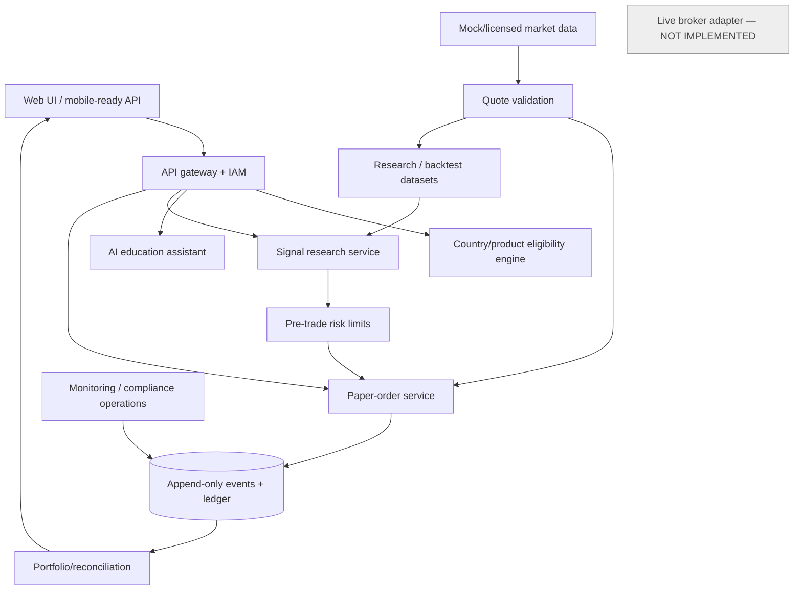

# Chapter III — Platform Architecture and Safety

## Initial technical mission
Create a repeatable and secure **paper-trading** system whose arithmetic and logs can be verified independently. Design for future global expansion, but no live execution path in the MVP.

## Components

## Core MVP requirements
1. UTC market timestamps, data provenance and outlier/stale-quote checks.
2. Deterministic order lifecycle: submitted → validated → accepted/rejected → filled/part-filled/cancelled.
3. Virtual balance and position reconciliation using decimal arithmetic and idempotency keys.
4. Explicit bid/ask, spread, latency, fee and slippage assumptions in simulations.
5. Signal model versioning, training-window disclosures and out-of-sample validation.
6. Paper bot opt-in, maximum position, simulated drawdown limits and kill switch.
7. AI assistant restricted to market education / factual product help; no profit promises or unapproved personalized advice.
8. Country/locale-aware UX with internationalization and local legal eligibility logic.
9. MFA-capable identity design, RBAC, secrets management, audit events and anti-abuse measures.
10. Accessibility, transparent demo labeling, risk disclosures and non-misleading performance presentation.

## Suggested stack
- Python 3.12+; FastAPI, Pydantic, pytest.
- PostgreSQL transactional store; Alembic migrations.
- Parquet + DuckDB for reproducible historical research; pandas/Polars.
- React/Next.js with TypeScript for customer-facing interfaces.
- Docker Compose locally and GitHub Actions CI.
- Background jobs and message queues only when load tests justify them.

## Financial invariants to test
- Every accepted simulated fill has exactly one ledger effect.
- Duplicate requests do not duplicate fills.
- Customer virtual equity is explained by cash, positions, fees, and unsettled P&L.
- Risk engine blocks prohibited simulated orders.
- Trading stops when account opts out or the kill switch fires.
- No backtest trains on future observations or uses unaccounted trading costs.

## Scope exclusions
No real deposits/withdrawals, custody, real-money trading, market-making/internalization, leverage offered to customers, personalized advice, or executing trades on behalf of retail customers.

## Expansion review
Live integration requires a fresh threat model, security audit, regulated-partner contracts, legal permissions, operations runbooks and formal approval. It cannot be activated by a feature flag alone.
